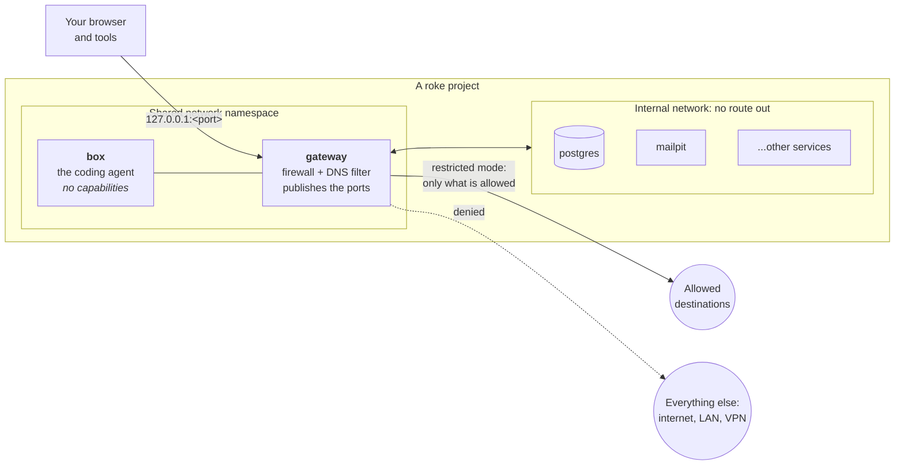

# Network

By default, a roke project can only reach the destinations you allow. The
agent, and every service it controls, cannot send your code or secrets
anywhere else, nor reach your LAN or your VPN.

- [How the pieces fit](#how-the-pieces-fit)
- [Restricted and open mode](#restricted-and-open-mode)
- [Allowing destinations](#allowing-destinations)
- [A port of your machine](#a-port-of-your-machine)
- [When something cannot connect](#when-something-cannot-connect)
- [Publishing ports](#publishing-ports)
- [Limitations](#limitations)

## How the pieces fit



- **The gateway** is the only container of the project with a route out.
  It runs the firewall (nftables) and a DNS filter (dnsmasq), and publishes
  the project's ports on `127.0.0.1`. It has `NET_ADMIN`, which it needs to
  set the firewall; the agent never runs in it.
- **The box**, where the agent runs, has no network of its own: it shares
  the gateway's. All its traffic therefore goes through the gateway's
  firewall, and it has no capabilities to change it.
- **The services** (databases, caches, Mailpit...) are on the project's
  internal network, which has no route out at all, in either mode. They can
  talk to the box and to each other, but not to the internet.

## Restricted and open mode

```dotenv
ROKE_NETWORK=restricted  # the default
ROKE_NETWORK=open        # no limits on the box's traffic
```

Set it in `roke.env` for every project, or in a project's `project.env`.
`roke --network open` overrides it for one run.

**Restricted** (default): the box can reach the project's services and the
allowed destinations, with any protocol (HTTPS, SSH, PostgreSQL, gRPC...).
Everything else is refused at once, so programs fail fast instead of hanging:

- **domains** that are not allowed do not resolve;
- **connections** to addresses that are not allowed are rejected, even if
  the program skips DNS or uses another DNS server: every DNS query from the
  box goes to the gateway's filter, whatever server it targets. This also
  stops data from leaking out through DNS queries.

**Open**: the box can reach anything your machine can, including your LAN
and your VPN. The services stay without a route out.

## Allowing destinations

The list of allowed destinations is built from several layers, so you only
add what is specific to you:

| Layer | Where | What it covers |
|---|---|---|
| Base | `docker/gateway/allow.txt` in this repository | What mise, the package managers and Serena need: GitHub, npm, PyPI, crates.io, Maven Central..., and Sigstore's trust root, with which mise verifies what it installs |
| Agent | `catalog/agents/<agent>/allow.txt` | The agent's API and login, and those of the agents in `ROKE_PARALLEL_AGENTS` (see [several agents at once](../catalog/agents/README.md#several-agents-at-once)) |
| Services | `catalog/services/<name>/allow.txt` | Rarely needed: services have no route out anyway |
| MCP servers | `allow` in `catalog/mcps/<name>/mcp.json` | What the project's [MCP servers](../catalog/mcps/README.md) need |
| Yours | `ROKE_NETWORK_ALLOW` in `roke.env` | Every project |
| The project's | `ROKE_NETWORK_ALLOW` in `project.env` | This project; adds to yours |

Each entry is one of:

| Entry | Allows |
|---|---|
| `example.com` | the domain and its subdomains, on any port |
| `*.example.com` | the same (written either way) |
| `db.example.com:5432` | the domain and its subdomains, on that port only |
| `203.0.113.10` | that address, on any port |
| `10.20.0.0/16:22` | that range, on that port only |
| `host:4401` | that port of your machine, the host (see [a port of your machine](#a-port-of-your-machine)) |

`roke network` shows allowed destinations and their sources.

The quickest way to add one to the current project:

```fish
roke network add db.staging.example.com:5432 --note "staging database"
roke network add ui.shadcn.com --note "shadcn/ui component registry"
```

`--note` says what a destination is for, and `roke network` shows it next to
it, as it does for the destinations roke allows by default. Adding a
destination again with another note changes it.

`roke network add` writes `ROKE_NETWORK_ALLOW` in the project's
`project.env`, one destination per line, each with its note; `--global`
writes it in `roke.env`, for every project. It applies from the next start
of the project. To edit it by hand, use `roke settings edit` (or
`--global`):

```dotenv
ROKE_NETWORK_ALLOW="
db.staging.example.com:5432  # staging database
ui.shadcn.com                # shadcn/ui component registry
# Corporate services
git.corp.example.com:22
"
```

A comment on a line of its own describes the destinations below it, until
a blank line. Notes cannot contain `"`, `$`, `` ` `` or `\`, since the
settings files are read by bash.

## A port of your machine

The box cannot reach your machine, the host, by design. To let it reach one
service running there, such as an MCP server or a development environment,
allow that port, one at a time:

```fish
roke network add host:4401
```

Inside the box, the host is `host.docker.internal`, so the agent reaches it
at `host.docker.internal:4401`. The whole host is never allowed: `host`
needs a port. The service on your machine must listen on an address Docker
can reach, such as `0.0.0.0`, not only on `127.0.0.1`.

## When something cannot connect

Run `roke network blocked` while the project is running or right after it
stops. Allow destinations you need with `roke network add`, then start the
project again. Known optional requests, such as dashboard news, are marked
with a reason and can stay blocked.

## Publishing ports

Since the box and the services have no ports of their own, the gateway
publishes them on `127.0.0.1`:

- **The box's**, with `-p` or `ROKE_PORTS`: the dev server listens in the
  gateway's network namespace; publish it with `roke -p 5173`.
- **The services' web UIs** (Mailpit, RustFS, Grafana, Jaeger...): each
  service's compose file asks the gateway to forward a port to it. See
  [publishing a service's port](../catalog/services/README.md#publishing-a-services-port).

Run `roke urls` to see all published ports, their destinations and binding
scope, including the services' UIs. It reads running containers and shows
configured ports separately when they differ. `roke network` lists allowed
outgoing destinations.

## Limitations

- **Programs that resolve names on their own**, for example with DNS over
  HTTPS to a hardcoded address, or that connect to fixed IPs, need those
  addresses allowed as IPs or ranges.
- **IPv6** is not used: the gateway only answers IPv4 addresses.
- **CDNs**: allowing a domain allows the addresses it resolves to while the
  project runs. A CDN may serve other sites from the same addresses, so
  allowing a CDN-hosted domain implicitly allows those too.
- **Credentials** inside the box can still be sent to an allowed
  destination that accepts them, such as the agent's own API. Keep the
  allowed list short and use keys with spending limits.
